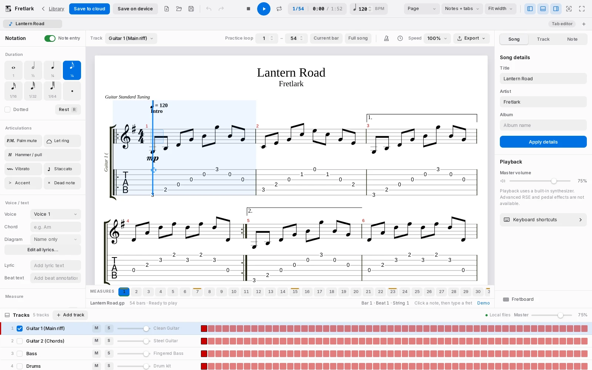
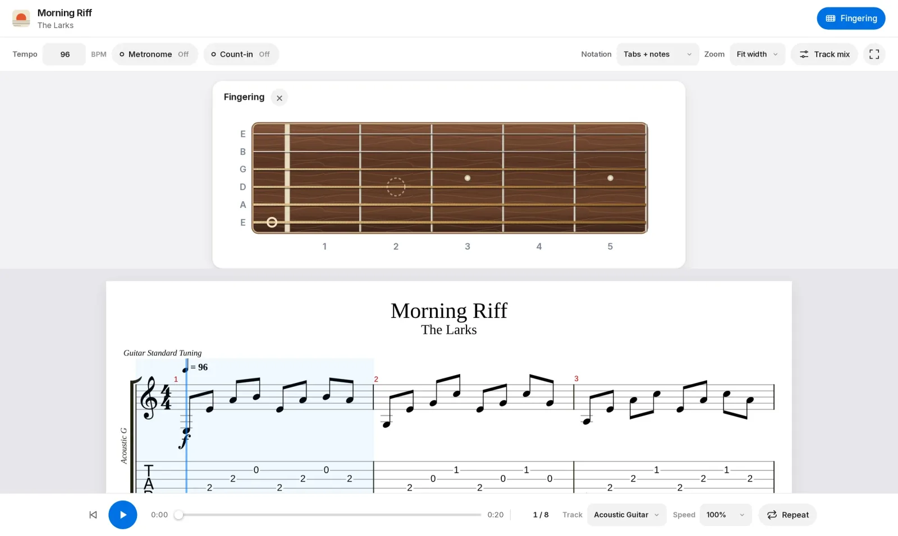
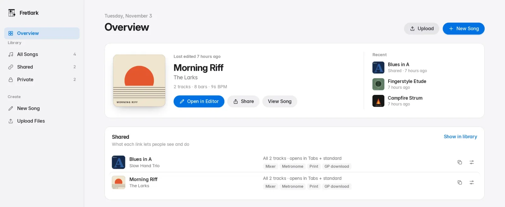
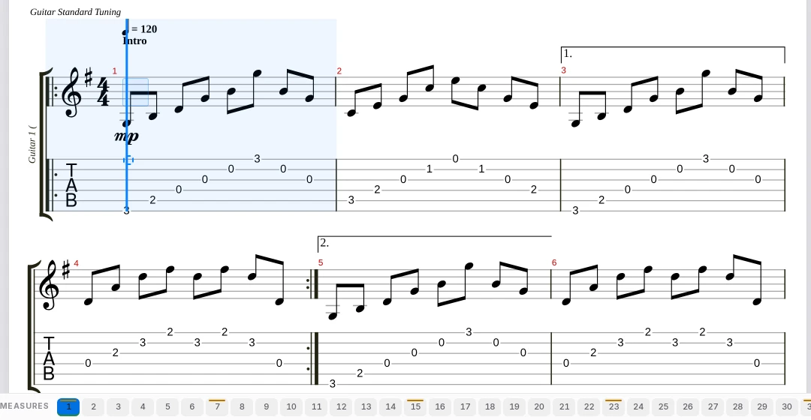

<div align="center">

# Fretlark

Write, play and share guitar tabs in your browser.

[Features](#features) · [Quick start](#quick-start) · [Self-host guide](SELF-HOSTING.md) · [Contributing](CONTRIBUTING.md)

[](LICENSE)
[](https://workers.cloudflare.com)
[](https://nodejs.org)

</div>



## Why Fretlark

- Free and open source under the MIT license.
- Opens Guitar Pro files, and exports them too.
- Runs on Cloudflare's free plan. No servers, no email service, no extra database.
- Songs can stay only on your device, never uploaded.

## Features

<table>
<tr>
<td width="50%" valign="top">
<strong>Practice and player</strong><br>
Slow down a song, loop any bar, mix tracks, and use the metronome and fretboard guide.<br>

</td>
<td width="50%" valign="top">
<strong>Library and sharing</strong><br>
A cloud library with album art and search. Share links let you choose the tracks, notation, printing and downloads.<br>

</td>
</tr>
<tr>
<td width="50%" valign="top">
<strong>Editor</strong><br>
Write notation and tab side by side, with a practice loop, track mixer, lyrics and chord diagrams.<br>
<br>
Best on a laptop or tablet screen.
</td>
<td width="50%" valign="top">
<strong>Also included</strong>
<ul>
<li>Techniques: bends, slides, palm mute, harmonics, tuplets, repeats and navigation signs.</li>
<li>Tunings, capo and scales on a fretboard.</li>
<li>Chords and chord diagrams, lyrics and a drum pad.</li>
<li>ASCII tab export and a command palette (Ctrl/⌘+E) with keyboard shortcuts.</li>
<li>Guitar Pro, MusicXML and alphaTex in; Guitar Pro, MIDI, WAV and ASCII tab out.</li>
<li>Accounts with a recovery key, optional two-factor login and owner tools.</li>
<li>Optional daily backups to R2.</li>
</ul>
</td>
</tr>
</table>

## Quick start

You need Node.js 22+ and a free [Cloudflare account](https://dash.cloudflare.com/sign-up).

```bash
git clone https://github.com/jscr3ator/Fretlark.git
cd Fretlark
npm install
npx wrangler login
npm run setup
```

`npm run setup` creates the database and storage, applies the schema, sets the secrets, deploys, and prints your address. Then create an account on your site and run:

```bash
npm run make-owner -- your-username
```

### Try it locally

```bash
npm install
npm run dev        # http://127.0.0.1:8787, no Cloudflare account needed
```

## Let an AI agent set it up

<details>
<summary>Show the prompt</summary>

```text
I want to self-host Fretlark, an open-source Guitar Pro style tab editor and player, on my own Cloudflare account.

Repo: https://github.com/jscr3ator/Fretlark
1. Clone it (or use the current folder if it is already cloned) and read AGENTS.md and SELF-HOSTING.md fully before changing anything.
2. Follow AGENTS.md to install, run the tests, and deploy to Cloudflare with `npm run setup`.
3. Ask me before: logging in to Cloudflare, choosing a custom domain, or closing public sign-ups. Never print or commit secrets.
4. When it is deployed, open /api/session on the new site to confirm it responds, create the first account, run `npm run make-owner -- <username>`, and tell me the final URL and anything I still need to do.

If anything fails, read the Troubleshooting section of SELF-HOSTING.md, fix it, and continue.
```

</details>

## Settings

| Name | Kind | Purpose |
| --- | --- | --- |
| `REGISTRATION_OPEN` | setting | `"true"` opens sign-ups, `"false"` closes them |
| `OWNER_ACCOUNT_ID` | setting | Account that manages users (set by `npm run make-owner`) |
| `MFA_ENCRYPTION_KEY` | secret | Encrypts two-factor secrets (created once by setup) |
| `STORAGE_LIMIT_MB` | setting, optional | Cloud storage per account in MB (default 500) |
| `BACKUP_BUCKET` | R2 binding, optional | Turns on the daily backup |

Details for each are in [SELF-HOSTING.md](SELF-HOSTING.md).

<details>
<summary>Show the project layout</summary>

```text
cloudflare/worker.mjs   entry point: routing, security headers, scheduled backup
lib/                    API, accounts, storage limits, artwork lookup (plain ES modules)
public/                 the whole front end (no build step)
  admin.html / admin.js   library (sign-in, songs, sharing, account settings)
  editor/                 editor, player, score model, bundled alphaTab
drizzle/                SQL migrations
scripts/                setup, make-owner, asset versioning
verify-*.{cjs,mjs}      tests (npm test)
```

</details>

## Contributing, security and license

Read [CONTRIBUTING.md](CONTRIBUTING.md) before opening a pull request, report vulnerabilities through [SECURITY.md](SECURITY.md), and check [THIRD-PARTY.md](THIRD-PARTY.md) for bundled components. Fretlark is released under the [MIT license](LICENSE).
